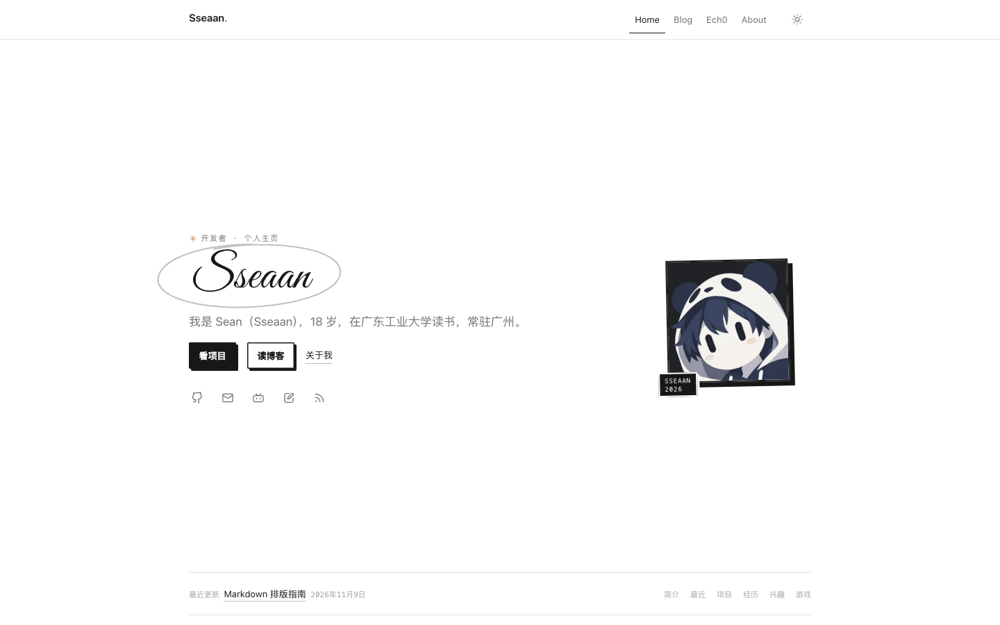
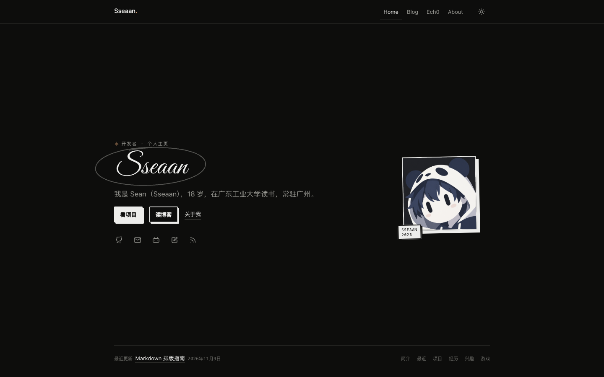

# Sseaan

[](https://github.com/sseaan/Homepage/actions/workflows/ci.yml) [](https://astro.build/) [](https://nodejs.org/) [](LICENSE)

轻量、克制、持续维护的个人主页：Home / Blog / Ech0 / About 四个入口，Astro 静态生成。

极简黑白为底，少量新粗野主义的粗边与硬阴影，手绘只作为页头、星号和圈选的批注出现。内容以 Markdown 管理，评论、动态和全站音乐分别在浏览器端连接独立服务，主站保持纯静态。

> 这是个人站点，不是可直接套用的通用主题。站点信息、导航、首页文案和社交链接都集中在 `src/config` 与 `src/data`，修改内容不需要改模板。

## 链接

- 线上站点：<https://ssean.cn>
- 仓库地址：<https://github.com/sseaan/Homepage>
- 工程规范与验收清单：[AGENT.md](./AGENT.md)
- Markdown 排版示例（草稿，不公开发布）：[`src/content/blog/markdown-guide.md`](./src/content/blog/markdown-guide.md)

## 预览

<p align="center">
  
  
</p>

## 特性

- **四个入口**：Home、Blog、Ech0、About；Header、页脚和页面容器共用 60rem 栏宽，文章正文 40rem。
- **极简视觉**：黑白灰阶、细线分隔、1.5–2px 粗边、直角与无模糊硬阴影；手绘装饰只出现在少量位置。
- **三态主题**：自动 → 白天 → 黑夜，点一次切换一次，首屏内联脚本避免闪烁。
- **Markdown 博客**：Content Collections + Zod 校验，支持草稿过滤、标签、阅读时长、RSS、sitemap、上一篇/下一篇和右侧树状目录。
- **Markdown 扩展**：提示块、`==高亮==`、行内/整段剧透、折叠、图注、画廊、任务列表、代码块语言/行号/复制按钮。
- **共享图片灯箱**：Blog 与 Ech0 共用一套 `<dialog>`，支持同组切换、Esc 关闭、焦点回归和滚动锁定。
- **文章分享**：X、邮件、生成分享卡片、复制链接；分享卡片是 1080px 宽的 PNG，可下载或长按保存。
- **全站音乐**：可选接入 api-enhanced；右下角「听歌」入口打开全局歌单，文章可用 frontmatter 覆盖为单曲/歌单并默认显示封面播放器。
- **Ech0 动态**：浏览器读取公开 Atom Feed，DOMPurify 清洗，按图片数量自动切换单图、轮播和宫格。
- **Twikoo 评论**：自托管固定版本客户端，懒加载、独立错误状态，主题切换不丢失草稿。
- **可访问性**：键盘焦点、跳转链接、减少动效、语义化状态提示和响应式布局。
- **质量保障**：Prettier、`astro check`、Vitest + jsdom、GitHub Actions CI。

## 开始使用

### 环境要求

- Node.js **24.18.0**（推荐；最低 22.23.4；见 `.nvmrc`）
- pnpm **12.18.0+**

> 本机如果同时装了 Node 26 等更新版本，`pnpm check` 依赖的 WASM 运行时可能崩溃；使用 Node 24.18.0 运行检查。

### 快速开始

```bash
pnpm install
cp .env.example .env   # 可选：评论 / 音乐需要时再填
pnpm dev               # http://localhost:4321
```

### 常用命令

| 命令                | 用途                                   |
| ------------------- | -------------------------------------- |
| `pnpm dev`          | 启动本地开发服务器                     |
| `pnpm build`        | 生成静态站点到 `dist/`                 |
| `pnpm preview`      | 预览构建产物                           |
| `pnpm check`        | Astro 类型 / 模板检查                  |
| `pnpm test`         | Vitest 单元测试                        |
| `pnpm format`       | Prettier 格式化                        |
| `pnpm format:check` | 检查格式（CI 使用）                    |
| `pnpm mock:twikoo`  | 启动本地 Twikoo mock，用于评论样式验收 |

## 部署

### EdgeOne Makers

1. 导入 GitHub 仓库，Framework Preset 选择 **Astro**。
2. 安装命令：`pnpm install --frozen-lockfile`。
3. 构建命令：`pnpm build`；输出目录：`dist`。
4. Node 版本选择 **24.18.0**（EdgeOne 的 22.11 / 22.17 / 22.21 都低于 Astro 7 要求的 22.23.4；24.18.0 已实测通过）。
5. 在 `main` 分支开启 Auto Deploy。
6. 设置生产环境变量 `SITE_URL=https://ssean.cn`（不要以 `/` 结尾），或在 `astro.config.mjs` 中修改默认域名。

静态站点不依赖 SPA fallback，`/about`、`/blog`、`/blog/<slug>` 可以直接访问和刷新。

### CI

`.github/workflows/ci.yml` 会执行：

- `pnpm install --frozen-lockfile`
- `pnpm format:check`
- `pnpm check`
- `pnpm test`
- `pnpm build`

EdgeOne 的自动部署由 push 触发；如果平台不等待 checks，建议用分支保护只合并通过 CI 的提交。

### 环境变量

| 变量                      | 何时需要            | 说明                                                                    |
| ------------------------- | ------------------- | ----------------------------------------------------------------------- |
| `SITE_URL`                | 生产环境建议设置    | canonical、Open Graph、RSS、sitemap 的绝对地址；默认 `https://ssean.cn` |
| `PUBLIC_TWIKOO_ENV_ID`    | 需要覆盖评论后端时  | Twikoo 后端根地址；未设置时使用 `src/config/site.ts` 中的值             |
| `PUBLIC_NETEASE_API_BASE` | 需要全站/文章音乐时 | api-enhanced 根地址；不设置时完全不输出播放器                           |

`PUBLIC_` 变量会进入浏览器构建产物，不要放密钥。Twikoo `envId` 和 api-enhanced 地址本身是公开地址。

## 配置与入口

### 站点信息

- `src/config/site.ts`：站点名、描述、域名、导航、社交链接、页脚、备案、Ech0、Twikoo、全站歌单。
- `src/data/home.ts`：首页简介、项目、经历、兴趣、游戏。
- `src/data/about.ts`：About 正文、正在做的事、技术分组与语言。
- `src/data/friends.ts`：友链。
- `astro.config.mjs`：`site`、sitemap、Markdown processor 与 Shiki 双主题。

未填写 `href` 的社交平台不会渲染；`author.avatar` 为 `null` 时会显示内置的手绘机器人占位。

### 目录结构

```text
src/
├── components/
│   ├── site/       Header、Footer、PageNav、Avatar
│   ├── home/       首页区块与项目/经历/兴趣/游戏行
│   ├── blog/       文章行、目录、分享、Markdown 增强
│   ├── music/      全站歌单面板 / 文章封面播放器
│   ├── media/      全站共享 Lightbox
│   ├── comments/   Twikoo 评论区
│   ├── icons/      Icon 与本地 SVG 路径
│   ├── doodles/    手绘圈选、箭头、星号
│   ├── splash/     点阵开屏
│   └── theme/      三态主题控制
├── content/blog/   Markdown 文章
├── layouts/        BaseLayout、BlogLayout
├── pages/          /、/about、/ech0、/blog、/blog/[...slug]、/rss.xml、/404
├── config/site.ts  站点级配置
├── data/           首页、About、友链
├── lib/            Ech0、Markdown 扩展、网易云解析与播放器逻辑
├── styles/         tokens / themes / global / prose-extras / comments / ech0
└── content.config.ts
```

## 内容与写作

### 新增文章

在 `src/content/blog/` 新建 `.md`：

```yaml
---
title: 文章标题
summary: 一到两句话概括文章内容。
pubDate: 2026-11-08
updatedDate: 2026-11-10 # 可选
tags:
  - 随笔
draft: false # true 时不会出现在列表、RSS、sitemap
# music: https://music.163.com/song?id=... # 可选，见「音乐播放器」
---
正文使用 Markdown。
```

- `title`、`summary`、`pubDate` 必填；字段错误会让构建失败并指出文件。
- `summary` 是纯文本，用于列表、文章摘要和 RSS description，不按 Markdown/HTML 渲染。
- **摘要里出现 `冒号+空格` 时必须用引号包住整段**，否则 YAML 会解析失败。
- 文章 URL 是 `/blog/<文件名>`；发布后不要改文件名，评论线程依赖稳定 pathname。
- `draft: true` 不会生成公开页面，也不会进入列表、RSS、sitemap。
- 文章图片支持灯箱；文末有上一篇/下一篇、分享卡片、复制链接和评论。

### Markdown 扩展

文章正文支持：

| 语法                             | 效果                                             |
| -------------------------------- | ------------------------------------------------ |
| `:::note[标题] ... :::`          | 提示块，支持 `note` / `tip` / `info` / `warning` |
| `{icon=✨}` / `data-icon="none"` | 自定义或隐藏提示块图标                           |
| `==文字==`                       | 高亮                                             |
| `:spoiler[文字]`                 | 行内剧透，点击显示                               |
| `:::spoiler ... :::`             | 整段剧透                                         |
| `:::details[标题]{open} ... :::` | 折叠内容，可默认展开                             |
| `<figure>` + `<figcaption>`      | 带图注的图片                                     |
| `<ul class="gallery cols-2">`    | 两列/三列画廊，灯箱同组切换                      |

代码块会自动加语言、行数、行号和复制按钮；外链自动在新标签页打开。完整示例和可直接复制的写法见仓库内草稿 [`markdown-guide.md`](./src/content/blog/markdown-guide.md)（`draft: true`，不在线上发布）。

实现位置：

- `src/lib/remark-markdown-extras.mjs`
- `src/components/blog/MarkdownEnhance.astro`
- `src/styles/prose-extras.css`
- `astro.config.mjs` 中的 `unified()` processor

### 图片与分享

- Blog 正文图片托管在 S3 / CDN：`https://img.mvr.cc/blog/<Post>/...`，Markdown 中使用完整 URL；本地文章图片副本已移除，S3 是唯一源。
- Blog 正文图片和 Ech0 动态共用 `src/components/media/Lightbox.astro`。
- 分享栏只有 X、邮件、分享卡片、复制链接。
- 分享卡片由 Canvas 生成，包含标题、摘要、正文首图、日期和站点地址；宽 1080px，可下载或长按保存。
- 首图优先使用正文首图；跨域 CDN 图片需要返回 `Access-Control-Allow-Origin`，否则卡片自动降级为不含首图的版本。

## 音乐播放器（api-enhanced）

全站播放器读取 `src/config/site.ts` 的 `music.playlist`：

```ts
music: {
  playlist: '18577886483', // 网易云歌单链接或纯数字歌单 ID；null 时不渲染
  label: '听歌', // 右下角入口按钮文字
},
```

默认只在右下角显示「听歌」入口，点击后展开歌单面板（封面、曲目列表、上一首/播放/下一首、进度条）；收起面板后音乐继续播放。未点击前不会请求 API，也不自动播放。

文章 frontmatter 的 `music` 会覆盖全站歌单，并在文章右下角默认显示现有封面按钮样式：

```yaml
music: https://music.163.com/song?id=123456
# music: '123456'                                      # 纯数字单曲 ID
# music: playlist:18577886483                          # 歌单（纯数字 ID 需要前缀）
# music: https://music.163.com/playlist?id=18577886483 # 歌单链接
```

然后在 `.env` 或部署平台设置 api-enhanced 根地址：

```bash
PUBLIC_NETEASE_API_BASE=https://music-api.example.com
```

歌曲详情走 `/song/detail?ids=`，歌单走 `/playlist/detail?id=` + `/playlist/track/all`；音频优先 `/song/url/v1?id=&level=exhigh`，失败回退 `standard` 和旧 `/song/url`。

注意：

- 站点为 HTTPS 时 API 地址也必须是 HTTPS。
- 浏览器需要能跨域访问 api-enhanced；服务端 `CORS_ALLOW_ORIGIN` 需包含站点域名。
- VIP、无音源或接口风控时显示「该歌曲暂不可播放」，不影响正文。
- 音频地址会从 `http:` 升级为 `https:`；请只播放有权使用的音乐。
- 未配置 `music.playlist`、文章 `music` 或 `PUBLIC_NETEASE_API_BASE` 时，播放器完全不输出。

## 评论（Twikoo 2.0.17）

评论后端：`https://tk.mvr.cc`（EdgeOne Makers + 自定义域名）。客户端固定在 `public/vendor/twikoo/twikoo-2.0.17.all.min.js`，不使用第三方 CDN。

- 评论区距离视口 400px 内才开始加载；加载中、空评论、脚本失败、超时、内部错误都有独立状态。
- 评论 path 固定为 `/blog/<slug>`，同一篇文章线程稳定。
- 样式在 `src/styles/comments.css`，只用 `.comments-shell .twikoo` 前缀覆盖，不 fork 上游。

本地没有后端时可以：

```bash
pnpm mock:twikoo
PUBLIC_TWIKOO_ENV_ID=http://127.0.0.1:4323 pnpm build
pnpm preview
```

<details>
<summary><strong>重新部署 Twikoo 后端</strong></summary>

1. 下载官方 [twikoo-edgeone-makers.zip](https://github.com/twikoojs/twikoo/raw/main/templates/edgeone-makers/twikoo-edgeone-makers.zip)（不要解压）。
2. EdgeOne Makers 控制台 → 项目 → 直接上传 → 上传 ZIP。
3. 在项目设置把 Node.js 版本改为 `24.18.0`，重新部署。
4. 绑定自定义域名并强制 HTTPS；平台默认域名只有 3 小时预览。
5. 访问后端根地址，出现「Twikoo 云函数运行正常」后，把地址填入 `PUBLIC_TWIKOO_ENV_ID` 并重新部署主站。

</details>

<details>
<summary><strong>已知限制</strong></summary>

- EdgeOne Makers 版 Twikoo 不支持 Akismet、腾讯云内容审核和 AI；垃圾评论需要人工审核或关键词规则。
- 邮件通知需要 SendGrid / MailChannels 或部署包内的 SMTP 桥接，直连 SMTP 不可用。
- 主站重新部署不会更新评论后端；升级 Twikoo 需要单独重新部署并做样式回归。
- 评论会收集昵称、邮箱和 IP 归属地；可在管理面板关闭地区/UA 展示。

</details>

## Ech0（只读动态）

`/ech0` 在浏览器中读取 `https://echo.ssean.cn/rss`，不经过主站服务端，构建也不依赖 Ech0 在线。

- 请求带 `credentials: 'omit'`，10 秒超时；按时间倒序、按 id 去重，默认展示 10 条。
- 加载中、空 Feed、网络失败、超时、解析失败都有独立状态和重试入口。
- Feed HTML 先经 DOMPurify 白名单清洗；script、style、iframe、事件属性和非 http(s) 链接都会被移除。
- 内部链接和图片升级为 HTTPS；图片使用懒加载和 `referrerpolicy="no-referrer"`，加载失败自动移除但保留正文。
- 图片按数量重排：1 张单图、2–4 张横向轮播、5 张以上 3 列宫格；超过 9 张时第 9 格显示剩余数量并链接回原站。
- 多个标签从正文抽出，横向排列在正文下方。
- 外链统一 `target="_blank"` + `rel="noopener noreferrer nofollow ugc"`。

配置在 `src/config/site.ts` 的 `ech0`：`feedUrl`、`siteUrl`、`maxItems`、`requestTimeoutMs`。

如果 Ech0 关闭 CORS，`/ech0` 会显示失败状态和原站入口，不影响其它页面。不要通过关闭浏览器安全策略解决；可改为服务端代理或直接展示 Ech0 原站。

<details>
<summary><strong>测试覆盖</strong></summary>

`pnpm test` 使用 `tests/fixtures/` 中的合成 Atom 覆盖：排序/去重/截断、非法日期、空 Feed、无效 XML、恶意标签与事件、危险协议、内部 http 升级、data URI 图片、纯文本 content。CI 不依赖真实 Feed。

</details>

## 视觉与主题

- 颜色只有中性灰阶 + 一个暖色强调（`--doodle-accent`），背景纯白 / 近黑。
- 全站 60rem 内容栏；文章正文 40rem，带右侧目录时使用 40rem + 12rem 双栏。
- 区块用细线和行式列表分隔，不堆叠卡片与阴影。
- 首页名字使用自托管的 **Great Vibes**（SIL OFL，来自 `@fontsource/great-vibes`，只加载 latin 400 子集），许可证见 `public/fonts/GreatVibes-LICENSE.txt`。
- 主题顺序固定为 **自动 → 白天 → 黑夜**；首屏由 `ThemeInit` 写回 `data-theme`，无 JS 时跟随系统。
- 开屏点阵约 1 秒，同一会话只播放一次；`prefers-reduced-motion: reduce` 时直接跳过。
- 手绘 `Doodle.astro` 提供 `underline / squiggle / arrow / arrow-down / asterisk / star / circle / ring / bracket / divider`，按需取用，不要每个标题都挂装饰。

## 质量与维护

```bash
pnpm format:check
pnpm check
pnpm test
pnpm build
```

当前测试覆盖 Ech0 解析/清洗、Markdown 扩展转换和网易云链接解析。CI 与本地使用同一组命令；发布前至少跑一次完整链。

## 字体与许可

- 代码遵循仓库 [LICENSE](./LICENSE)，为 **GNU AGPL v3.0**。
- 文章、图片和站点文案如无特别说明，版权归作者所有。
- Great Vibes 使用 SIL Open Font License 1.1，许可证见 `public/fonts/GreatVibes-LICENSE.txt`。
- Twikoo 客户端为 MIT；Ech0、api-enhanced、Astro、Lucide 等依赖遵循各自许可证。

## 致谢

- README 结构与主题表达参考 [cxro/astro-whono](https://github.com/cxro/astro-whono)。
- 早期排版密度参考 [sn0w.fyi](https://sn0w.fyi/)。
- 感谢 [Astro](https://astro.build/)、[Twikoo](https://github.com/twikoojs/twikoo)、[Ech0](https://github.com/lin-snow/Ech0)、[api-enhanced](https://github.com/NeteaseCloudMusicApiEnhanced/api-enhanced)、[Lucide](https://lucide.dev/) 和 [Fontsource](https://fontsource.org/)。
